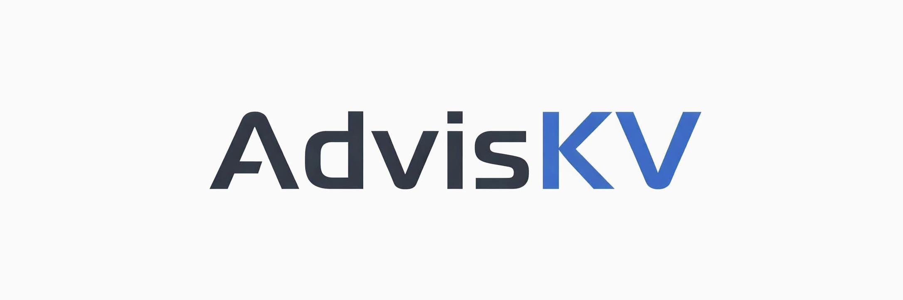

<p align="center">
  
</p>

<p align="center">
  
  <a href="LICENSE"></a>
  
  
</p>

<p align="center">
  <a href="README.md">中文版本</a>
</p>

AdvisKV is a from-scratch distributed Key-Value storage prototype built with **C++17 + gRPC + Protobuf + Raft**. Users access data with a `db + table + key` model: `Catalog` manages DDL and the database/table catalog, `Topo` manages Storage nodes, shard replicas, and routes, `Storage` handles KV reads/writes, Raft replication, WAL, snapshots, and local recovery, and `SDK` routes requests to the corresponding shard leader.

The current V1 runs a local main path covering database/table creation, table sharding, multi-replica placement, replica-count changes, abnormal replica replacement, Raft leader election, log replication, snapshot catch-up, and crash recovery. The repository also includes GoogleTest, Python E2E tests, benchmarks, and metrics reports.

## Implemented so far

- Database/table model, sharding, and routing: users access data with `db + table + key`; Catalog manages databases, tables, and DDL, Topo maintains shard replicas and routes, and the SDK sends requests to the corresponding shard leader.
- Replica-count changes and abnormal replica replacement: `AlterTableReplicaCount` supports `0 -> N`, `N -> 0`, and `N -> M`; Topo cleans up `LOST` / `ERROR` replicas and attempts to add replacements through Raft membership changes.
- Raft replication and persistence recovery: Storage replicates KV writes with Raft and includes WAL, snapshots, log catch-up, and restart recovery.
- Tests and local benchmarks: more than two hundred GoogleTest cases and Python E2E tests cover Raft leader election, log and snapshot catch-up, replica-count changes, scale-to-zero, and crash recovery. In a local three-replica test, put reached about 9.8k QPS with a 5.6 ms P99, while get reached about 11k QPS with a 2.2 ms P99. These numbers are for local tuning and regression comparison only.

## Architecture

```text
Client / CLI / Benchmark
        |
        v
       SDK
        |
        | GetRoute(db, table, key)
        v
       TOPO  <-------------------- Storage NodeAgent HeartBeat
        ^                         |
        |                         | Apply ExpectedReplica
        |                         v
   Catalog  ---- PlaceTable ---- Storage Replica / Raft / WAL / KV
```

Main flows:

```text
DDL:
Client -> Catalog CreateTable -> TOPO PlaceTable -> NodeAgent HeartBeat
       -> Apply ExpectedReplica -> Replica READY -> Route READY -> Catalog NORMAL

Data:
SDK -> TOPO GetRoute -> Storage leader Put/Get/Delete -> Raft -> KV StateMachine
```

## Quick Start

Recommended environment: Linux (Ubuntu 24.04), a C++17 compiler, CMake 3.20+, Ninja, Git, and Python 3.

```bash
git submodule update --init --recursive
./scripts/setup.sh
./scripts/build.sh
./scripts/adviskvctl_demo.sh
```

To prepare the optional Maelstrom test environment, replace the setup command above with:

```bash
./scripts/setup.sh --with-maelstrom-test
```

`adviskvctl_demo.sh` starts a local `topo/catalog/storage` cluster and opens an interactive shell. Example commands:

```text
create_db demo_db dc1
create_table demo_db demo_table 1 1 default
wait_table demo_db demo_table
put demo_db demo_table k1 v1
get demo_db demo_table k1
route demo_db demo_table k1
quit
```

Stop local processes:

```bash
./scripts/stop_cluster.sh
```

## Build

Recommended script-based build:

```bash
./scripts/build.sh
```

You can also invoke CMake directly:

```bash
cmake -S . -B build -G Ninja -DCMAKE_BUILD_TYPE=Debug
cmake --build build --parallel
```

Common build variables:

```bash
BUILD_TYPE=Debug ./scripts/build.sh
BUILD_TARGETS="catalog topo storage adviskvctl" ./scripts/build.sh
```

Main binaries are generated under `build/bin/` by default.

## Test

```bash
./scripts/run_test.sh
./scripts/e2e_pytest.sh
./scripts/coverage.sh
```

- `run_test.sh`: builds and runs GoogleTest suites; if Maelstrom is installed, it also runs a normal 3-node Raft test followed by a 5-node fault-injection stress test.
- `e2e_pytest.sh`: starts a local multi-process cluster and verifies the Catalog -> Topo -> Storage -> SDK main path.
- `coverage.sh`: generates a coverage report.

E2E tests cover basic KV operations, restart recovery, leader failover, follower catch-up, crash recovery, scale-to-zero, replica-count changes, and failure scenarios.

## Benchmark

The benchmark reports below measure local flows through `SDK -> Topo route -> Storage leader -> Raft/WAL/KV`. The results come from a local multi-process setup and are intended for tuning and regression comparison.

Test environment: `Mac15,7`, Apple M3 Pro, 12 physical cores / 12 logical CPUs, 36 GiB memory, macOS 15.7.4, arm64. Local cluster: `1 catalog + 1 topo + 5 storage`, all processes running on the same machine and communicating through `127.0.0.1/localhost`.


Default scenario: `threads=16`, `shard_count=2`, `replica_count=3`, `value_size=128`, `requests=30000`.

| Workload | Scenario | success_qps | avg_us | p95_us | p99_us |
|---|---|---:|---:|---:|---:|
| put | baseline | 9799.99 | 1631.30 | 2577 | 5623 |
| get | baseline | 11059.01 | 1445.76 | 1905 | 2211 |
| mixed | read_ratio=0.80 | 8229.54 | 1942.99 | 3358 | 4474 |

Full reports:

- [Put benchmark](docs/benchmark/benchmark_put.md)
- [Get benchmark](docs/benchmark/benchmark_get.md)
- [Mixed benchmark](docs/benchmark/benchmark_mixed.md)

Run a single benchmark:

```bash
./scripts/bench.sh --workload=put --threads=4 --requests=10000 --replica_count=3
```

Run a benchmark and generate a metrics text report:

```bash
./scripts/bench_metrics.sh --workload=put --threads=4 --requests=10000 --replica_count=3
```

`bench_metrics.sh` uses the same arguments as `bench.sh`, samples service `/metrics` endpoints plus the benchmark client's SDK metrics during the run, and prints the report path at the end:

```text
[bench] metrics report: build/bench/<run_id>/metrics_report.txt
```

The report lists latency histogram deltas and counter deltas that changed during the run, including `sdk_*` rows from the benchmark client, which makes it useful for local tuning and regression comparison.

## Documentation

- [scripts/README.md](scripts/README.md): common script entry points.
- [conf/README.md](conf/README.md): conf layout and local run directories (`demo` / `unit_test` / `e2e_test` / `bench`).
- [docs/benchmark/README.md](docs/benchmark/README.md): V1 benchmark entry and result summary.
- [docs/接口规范.md](docs/接口规范.md): RPC and SDK interface semantics (Chinese).
- [Design blog](https://www.zhihu.com/column/c_2057637599590797905): project design notes.

## Project Layout

```text
conf/       local config files
proto/      gRPC / Protobuf definitions
scripts/    build, test, demo and benchmark scripts
src/        Catalog, Topo, Storage, SDK and common modules
tools/      adviskvctl, e2e client, benchmark client, storage client
test/       GoogleTest and Python E2E tests
docs/       design notes and V1 constraints
```

## Current limitations

- Catalog and Topo currently run as single local processes and are not highly available.
- The current implementation supports replica-count changes and abnormal replica replacement, but not shard-count changes or automatic rebalancing.
- Storage currently uses a map-based KV engine.

## License

AdvisKV is licensed under the [MIT License](LICENSE).
