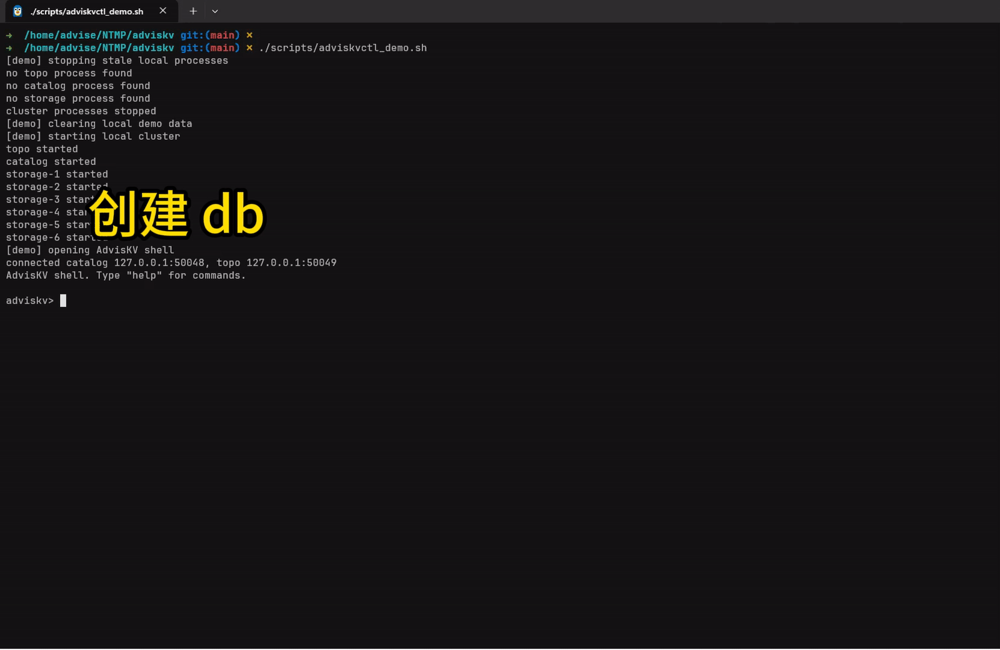

# AdvisKV

**C++17 分布式 KV 存储系统**

库表管理 · 哈希区间分片 · Raft 复制 · 副本数调整 · 持久化与故障恢复


[English](README.en.md) · [快速开始](#快速开始) · [设计博客](#设计博客) · [Benchmark](#基准测试) · [当前限制](#当前限制)

---

## 项目简介

AdvisKV 是 C++17 分布式 Key-Value 存储系统，一个小而完整的分布式KV，当前版本是 v0.1.9。

数据按 `db + table + key` 组织。Meta 负责库表和集群管理，Storage 存储数据，客户端通过 SDK 访问。

## 目前支持

- Put、Get、Delete，以及 CAS（值符合预期时才更新）。
- 库表管理、哈希区间分片和 SDK 路由缓存。
- 在线调整副本数，自动替换坏副本。
- Raft 复制、基于 ReadIndex 的线性一致读，以及 PreVote 预选举。
- WAL 和 Snapshot 持久化，Storage 与 Meta 重启恢复。
- SDK 自动重试和写请求去重。
- 单元测试、多进程端到端测试、日志和运行指标。

## 快速开始

环境要求：推荐使用 Linux（Ubuntu 24.04）、C++17 编译器、CMake 3.20+、Ninja、pkg-config、Git 和 Python 3。

首次构建前初始化依赖：

```bash
git submodule update --init --recursive
./scripts/setup.sh
./scripts/build.sh
```

如果需要运行 Maelstrom 测试，把上面的 setup 命令替换为：

```bash
./scripts/setup.sh --with-maelstrom-test
```

启动本地集群并打开 `adviskvctl`：

```bash
./scripts/adviskvctl_demo.sh
```

在交互式 shell 中执行：

```text
create_db demo_db dc1
create_table demo_db demo_table 1 1 default
wait_table demo_db demo_table
put demo_db demo_table k1 v1
get demo_db demo_table k1
cas demo_db demo_table k1 v1 v2
get demo_db demo_table k1
shards demo_db demo_table
route demo_db demo_table k1
quit
```

本地演示：



Demo 退出时会停止演示集群；也可以手动执行：

```bash
./scripts/stop_cluster.sh
```


### 手动构建

```bash
cmake -S . -B build -G Ninja -DCMAKE_BUILD_TYPE=Debug
cmake --build build --parallel
```

也可以通过环境变量选择构建类型或目标：

```bash
BUILD_TYPE=Release ./scripts/build.sh
BUILD_TARGETS="meta storage adviskvctl" ./scripts/build.sh
```

主要二进制位于 `build/bin/`。

## 架构


| 模块      | 作用                                             |
| ------- | ---------------------------------------------- |
| Meta    | 持久化库表，管理 Storage 节点、副本和路由。                     |
| Storage | 为分片提供 KV 读写，用 Raft、WAL 和 Snapshot 完成复制、持久化与恢复。 |
| SDK     | 缓存路由，将请求发送到对应 Leader。                          |


一次写请求的大致路径：

```text
SDK → RouteCache → Storage Leader
    → Raft → WAL 持久化 / 多数派提交 → KV StateMachine
```

//todo

## 测试

运行 C++ 测试：

```bash
./scripts/run_test.sh
```

脚本先构建并运行 GoogleTest。如果检测到 Maelstrom 和对应测试程序，还会运行一个无故障的 3 节点 Raft 测试，再运行一个 5 节点网络分区压力测试；未安装时跳过 Maelstrom。可以通过 `./scripts/setup.sh --with-maelstrom-test` 准备可选环境。

运行 Python E2E 测试：

```bash
./scripts/e2e_pytest.sh
```

生成覆盖率报告：

```bash
./scripts/coverage.sh
```

## 基准测试

[v0.1.0 历史 Benchmark 报告](docs/v0.1.0/benchmark/README.md)

## 设计博客

- [AdvisKV 设计博客专栏](https://www.zhihu.com/column/c_2057637599590797905)

## 文档

- [接口规范](docs/接口规范.md)：Meta、Storage 和 SDK 的 RPC 与调用语义；最新接口定义见 `proto/` 和 `src/sdk/client.h`。
- [配置](conf/README.md)：`conf/` 与 `build/demo|unit_test|e2e_test|bench` 路径说明。
- [v0.1.0 版本说明](docs/版本.md)：版本能力摘要与后续计划。
- [v0.1.0 历史 Benchmark](docs/v0.1.0/benchmark/README.md)：原始运行环境和结果说明。
- [v0.1.0 SDK 重试验收](docs/v0.1.0/retry.md)：历史写请求重试和 Leader 故障切主验收结果。

## 项目结构

```text
conf/       配置文件
proto/      gRPC / Protobuf 定义
scripts/    构建、测试、demo 和 benchmark 脚本
src/        Meta / Storage / SDK 与通用模块
tools/      adviskvctl、E2E 客户端、benchmark 客户端、Storage 客户端
test/       GoogleTest 和 Python E2E 测试
docs/       设计文档、版本说明与 benchmark
```

## 当前限制

以下边界以当前代码为准：

- `request_id` 暂无 TTL
- KV 引擎当前是内存 Map
- 坏副本替换过程中，原副本恢复时仍可能优先移除新副本
- 暂不支持分片分裂、动态副本迁移与自动负载均衡
- Meta 目前仍是单进程，不是控制面高可用。

