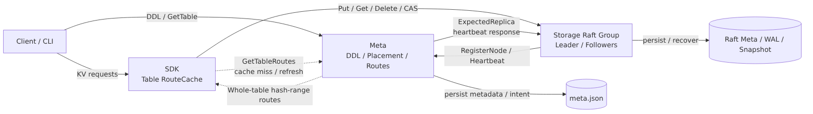

<h1 align="center">AdvisKV</h1>

<p align="center">
  <b>一个 C++17 分布式 KV 存储原型</b><br/>
  库表管理 · 分片路由 · Raft 复制 · 副本数调整 · 故障恢复
</p>

<p align="center">
  
  
  <a href="LICENSE"></a>
  
  
</p>

<p align="center">
  <a href="README.en.md">English</a> ·
  <a href="#快速开始">快速开始</a> ·
  <a href="#设计博客">设计博客</a> ·
  <a href="docs/benchmark/README.md">Benchmark</a> ·
  <a href="#当前限制">当前限制</a>
</p>

---

## 项目简介

AdvisKV 是我用 C++17 从零实现的分布式 KV 存储原型。客户端以 `db + table + key` 访问数据：Catalog 管理库表和 DDL，Topo 管理 Storage 节点、分片副本和路由，Storage 使用 Raft 复制数据，WAL 和 Snapshot 负责持久化与恢复，SDK 根据路由把请求发送到对应分片的 Leader。

目前可以在本地多进程环境中完成建库建表、KV 读写、副本数调整、异常副本替换、Raft 选主、日志复制、Snapshot 追赶和重启恢复。仓库提供 C++ 单元测试、Python E2E 测试、benchmark 和 metrics。

## 目前支持

- **库表与分片路由**：支持建库、建表和基本 DDL；SDK 按 `db + table + key` 获取路由，并把请求发送到对应分片的 Leader。
- **副本数在线调整**：`AlterTableReplicaCount` 支持从 0 个副本启动、缩容到 0 个以及 `N → M` 的调整。副本进入 `LOST` 或 `ERROR` 后，Topo 会清理旧副本并补充新副本，Storage 通过 Raft 成员变更将其加入集群。
- **Raft 复制与恢复**：Storage 使用 Raft 复制 KV 写入，并通过 WAL、Snapshot、日志追赶和重启恢复保持副本状态。
- **测试与状态观测**：GoogleTest 覆盖 Raft、Replica、WAL、Snapshot 等模块，Python E2E 测试覆盖多进程链路；服务端和 SDK 提供日志与 metrics。

## 快速开始

环境要求：推荐使用 Linux（Ubuntu 24.04）、C++17 编译器、CMake 3.20+、Ninja、Git 和 Python 3。

首次构建前初始化依赖：

```bash
git submodule update --init --recursive
./scripts/setup.sh
./scripts/build.sh
```

如果需要运行 Maelstrom 测试，把上面的 setup 命令替换为：

```bash
./scripts/setup.sh --with-maelstrom-test
```

启动本地集群并打开 `adviskvctl`：

```bash
./scripts/adviskvctl_demo.sh
```

在交互式 shell 中执行：

```text
create_db demo_db dc1
create_table demo_db demo_table 1 1 default
wait_table demo_db demo_table
put demo_db demo_table k1 v1
get demo_db demo_table k1
route demo_db demo_table k1
quit
```

Demo 退出时会清理本地进程；也可以手动执行：

```bash
./scripts/stop_cluster.sh
```

### 手动构建

```bash
cmake -S . -B build -G Ninja -DCMAKE_BUILD_TYPE=Debug
cmake --build build --parallel
```

也可以通过环境变量选择构建类型或目标：

```bash
BUILD_TYPE=Release ./scripts/build.sh
BUILD_TARGETS="catalog topo storage adviskvctl" ./scripts/build.sh
```

主要二进制位于 `build/bin/`。

## 架构

<p align="center">
  
</p>

| 模块 | 作用 |
| --- | --- |
| Catalog | 保存库表定义，处理建库、建表和其他 DDL。 |
| Topo | 管理 Storage 节点、分片副本和路由，推进副本状态变化。 |
| Storage | 为分片提供 KV 读写，用 Raft、WAL 和 Snapshot 完成复制与恢复。 |
| SDK | 获取并缓存路由，将请求发送到对应分片的 Storage Leader。 |

一次写请求的大致路径：

```text
SDK → Topo 路由 → Storage Leader → Raft → WAL / KV StateMachine
```

数据面时序：

<p align="center">
  
</p>

模块图：

- [Topo 最小架构](docs/assets/mermaid/topo-minimal-architecture.png)
- [Storage 最小架构](docs/assets/mermaid/storage-minimal-architecture.png)
- [Catalog 最小架构](docs/assets/mermaid/catalog-minimal-architecture.png)

## 测试

运行测试：

```bash
./scripts/run_test.sh
```

如果本地已经安装 Maelstrom，还会先运行一个无故障的 3 节点 Raft 测试，再运行一个 5 节点的故障注入压力测试，否则跳过 Maelstrom。
想要跑 Maelstrom，可以使用
```bash
./scripts/setup.sh --with-maelstrom-test
```
先安装Maelstrom

运行 Python E2E 测试：

```bash
./scripts/e2e_pytest.sh
```

生成覆盖率报告：

```bash
./scripts/coverage.sh
```

当前仓库包含两百多个 GoogleTest 用例。E2E 测试覆盖基础 KV 链路、重启恢复、Raft 选主、日志和 Snapshot 追赶、副本数调整、scale-to-zero 以及故障恢复场景。

## 基准测试

Benchmark 测量的是本地多进程环境中的 `SDK → Topo route → Storage Leader → Raft / WAL / KV` 链路。

测试环境：`Mac15,7`、Apple M3 Pro、12 物理核心 / 12 逻辑 CPU、36 GiB 内存；macOS 15.7.4、arm64。集群包含 1 个 Catalog、1 个 Topo 和 5 个 Storage，进程通过 `127.0.0.1` / `localhost` 通信。


默认场景：`threads=16`、`shard_count=2`、`replica_count=3`、`value_size=128`、`requests=30000`。

| Workload | Scenario | success_qps | avg_us | p95_us | p99_us |
| --- | --- | ---: | ---: | ---: | ---: |
| put | baseline | 9799.99 | 1631.30 | 2577 | 5623 |
| get | baseline | 11059.01 | 1445.76 | 1905 | 2211 |
| mixed | read_ratio=0.80 | 8229.54 | 1942.99 | 3358 | 4474 |

完整报告：

- [Put benchmark](docs/benchmark/benchmark_put.md)
- [Get benchmark](docs/benchmark/benchmark_get.md)
- [Mixed benchmark](docs/benchmark/benchmark_mixed.md)

运行单次 benchmark：

```bash
./scripts/bench.sh --workload=put --threads=4 --requests=10000 --replica_count=3
```

运行 benchmark 并采样 metrics：

```bash
./scripts/bench_metrics.sh --workload=put --threads=4 --requests=10000 --replica_count=3
```

报告默认写入 `build/bench_results/<run_id>/metrics_report.txt`。

## 设计博客

- [AdvisKV 设计博客专栏](https://www.zhihu.com/column/c_2057637599590797905)

## 文档

- [接口规范](docs/接口规范.md)：Catalog、Topo、Storage 和 SDK 的 RPC 与调用语义。
- [Benchmark 说明](docs/benchmark/README.md)：Benchmark 的运行方式和结果说明。

## 项目结构

```text
conf/       本地配置文件
proto/      gRPC / Protobuf 定义
scripts/    构建、测试、demo 和 benchmark 脚本
src/        Catalog / Topo / Storage / SDK 与通用模块
tools/      adviskvctl、E2E 客户端、benchmark 客户端、Storage 客户端
test/       GoogleTest 和 Python E2E 测试
docs/       设计文档、博客与 benchmark
```

## 当前限制

- Catalog 和 Topo 目前以单进程本地模式运行，控制面还没有高可用。
- 当前支持副本数调整，不支持分片数变更和自动 Rebalance。
- Storage 使用 map-based KV engine。

