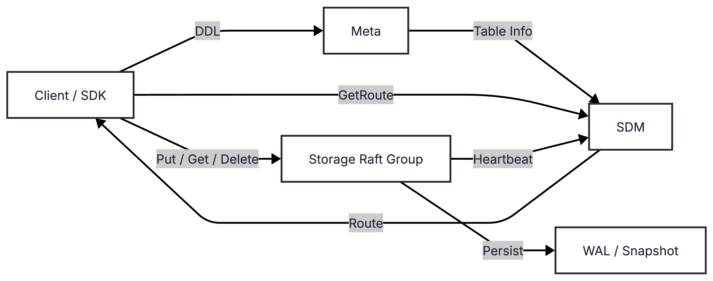
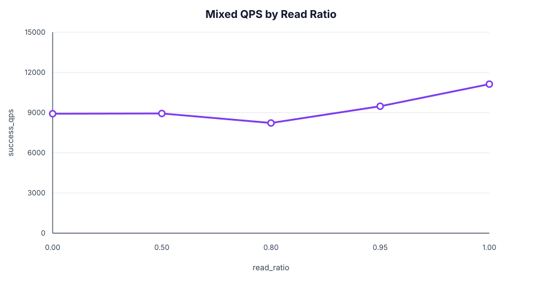

<h1 align="center">AdvisKV</h1>

<p align="center">
  <b>一个从零实现的 C++17 分布式 KV 存储原型</b><br/>
  Catalog/Topo · Raft 副本复制 · 分片路由 · 副本数调整 · WAL/Snapshot 恢复
</p>

<p align="center">
  
  
  <a href="LICENSE"></a>
  
  
</p>

<p align="center">
  <a href="README.en.md">English</a> ·
  <a href="#快速开始">快速开始</a> ·
  <a href="https://www.zhihu.com/column/c_2057637599590797905">设计博客</a> ·
  <a href="docs/benchmark/README.md">Benchmark</a> ·
  <a href="#当前状态">当前状态</a>
</p>

---

## 项目简介

AdvisKV 是我从零设计并实现的 C++17 分布式 KV 存储原型。用户以 `db + table + key` 的形式访问数据：Catalog 负责库表目录和 DDL，Topo 负责 Storage 节点、分片副本与路由，Storage 基于 Raft 完成数据复制，并通过 WAL/Snapshot 支持持久化与恢复，SDK 根据路由将请求发送到对应分片的 Leader。

当前 V1 已在本地多进程环境下跑通建库建表、KV 读写、副本数调整、异常副本替换、Raft 选主、日志复制与 Snapshot 追赶，以及若干崩溃恢复场景。同时配套了单元测试、E2E 测试、日志和 metrics，用于验证关键状态及故障场景下的行为。

## 主要实现

- **库表、分片与路由**。用户通过 `db + table + key` 访问数据，Catalog 负责库表和 DDL，Topo 维护分片副本与路由，SDK 将请求发送到对应分片的 Leader。
- **副本数调整与异常副本替换**。`AlterTableReplicaCount` 支持 `0 → N`、`N → 0` 和 `N → M`；副本进入 `LOST` / `ERROR` 后，Topo 会清理旧副本并尝试补充新副本，Storage 侧通过 Raft 成员变更将其加入集群。
- **Raft 复制与持久化恢复**。Storage 使用 Raft 复制 KV 写入，并配套 WAL、Snapshot、日志追赶和重启恢复。
- **测试与本地 benchmark**。包含两百多个 GoogleTest 用例和一组 Python E2E 测试，覆盖 Raft 选主、日志与 Snapshot 追赶、副本数调整、scale-to-zero 和崩溃恢复。本地三副本测试中，put P99 约 5.6 ms（约 9.8k QPS），get P99 约 2.2 ms（约 11k QPS）；这些数据仅用于本地调优和回归对比。

## 架构

<p align="center">
  
</p>

- **Client / SDK**:走 `db + table + key` 路由,后台异步刷新整表路由后直连 Storage 做 `put/get/delete`;RouteCache 采用 COW + atomic snapshot,读路径无锁。
- **Catalog**:DDL / catalog 的单一权威源,建表时把表信息交给 Topo 编排落地。
- **Topo**:reconciler 驱动的控制面,接收 Storage NodeAgent Heartbeat,下发 ExpectedReplica,把 desired state 收敛为 observed state,再对外发布 route。
- **Storage Raft Group**:多副本 Raft 复制,leader 负责写路径;WAL 顺序落盘、Snapshot install、Log truncate 与 crash recovery 全部覆盖。

数据面主链路的时序：

<p align="center">
  
</p>


更细的模块图：
- [Topo 最小架构](docs/assets/topo-minimal-architecture.png)
- [Storage 最小架构](docs/assets/storage-minimal-architecture.png)
- [Catalog 最小架构](docs/assets/meta-minimal-architecture.png)

## 快速开始

准备环境：macOS 或 Linux、C++17 编译器、CMake 3.20+、Ninja、Git、Python 3。

```bash
./scripts/setup.sh
./scripts/build.sh
./scripts/adviskvctl_demo.sh
```

`adviskvctl_demo.sh` 会自动拉起本地 `topo/catalog/storage`，并进入交互式 shell：

```text
create_db demo_db dc1
create_table demo_db demo_table 1 1 default
wait_table demo_db demo_table
put demo_db demo_table k1 v1
get demo_db demo_table k1
route demo_db demo_table k1
quit
```

停止本地进程：

```bash
./scripts/stop_cluster.sh
```

## 构建

推荐使用脚本构建：

```bash
./scripts/build.sh
```

也可以直接调用 CMake：

```bash
cmake -S . -B build -G Ninja -DCMAKE_BUILD_TYPE=Debug
cmake --build build --parallel
```

常用构建变量：

```bash
BUILD_TYPE=Debug ./scripts/build.sh
BUILD_TARGETS="catalog topo storage adviskvctl" ./scripts/build.sh
```

主要二进制默认位于 `build/bin/`。

## 测试

```bash
./scripts/run_test.sh
./scripts/e2e_pytest.sh
./scripts/coverage.sh
```

- `run_test.sh`:构建并运行 GoogleTest。
- `e2e_pytest.sh`:拉起本地多进程集群,验证 Catalog → Topo → Storage → SDK 主链路。
- `coverage.sh`:生成覆盖率报告。

E2E 覆盖基础 KV、重启恢复、leader failover、follower catch-up、crash recovery、scale-to-zero、副本数调整和故障场景。

## 基准测试

本地 benchmark 覆盖 `SDK → Topo route → Storage leader → Raft/WAL/KV`。结果来自单机多进程集群，只代表当前 V1 的测试结果，**不是生产环境性能承诺**。

测试环境：`Mac15,7`、Apple M3 Pro、12 物理核心 / 12 逻辑 CPU、36 GiB 内存；macOS 15.7.4、arm64。本地集群：`1 catalog + 1 topo + 5 storage`，所有进程都在同一台机器上，通过 `127.0.0.1/localhost` 通信。



默认场景:`threads=16`、`shard_count=2`、`replica_count=3`、`value_size=128`、`requests=30000`。

| Workload | Scenario | success_qps | avg_us | p95_us | p99_us |
|---|---|---:|---:|---:|---:|
| put | baseline | 9799.99 | 1631.30 | 2577 | 5623 |
| get | baseline | 11059.01 | 1445.76 | 1905 | 2211 |
| mixed | read_ratio=0.80 | 8229.54 | 1942.99 | 3358 | 4474 |

完整报告：

- [Put benchmark](docs/benchmark/benchmark_put.md)
- [Get benchmark](docs/benchmark/benchmark_get.md)
- [Mixed benchmark](docs/benchmark/benchmark_mixed.md)

运行单次 benchmark：

```bash
./scripts/bench.sh --workload=put --threads=4 --requests=10000 --replica_count=3
```

运行 benchmark 并生成 metrics 文本报告：

```bash
./scripts/bench_metrics.sh --workload=put --threads=4 --requests=10000 --replica_count=3
```

`bench_metrics.sh` 与 `bench.sh` 使用同一套参数，只是在 benchmark 期间采样服务端 `/metrics` 和 benchmark 客户端里的 SDK metrics，结束后输出报告路径：

```text
[bench] metrics report: build/bench_results/<run_id>/metrics_report.txt
```

## 设计博客

- [设计博客专栏](https://www.zhihu.com/column/c_2057637599590797905)

## 文档

- [V1 约束与状态语义](docs/约束.md)：Catalog、Topo 与 Replica 的状态和字段边界。
- [副本数调整时序](docs/约束2.md)：副本扩容、加入 Raft 和状态收敛的时序记录。
- [Benchmark 说明](docs/benchmark/README.md)：本地 benchmark 的运行方式和结果说明。

## 项目结构

```text
conf/       本地配置文件
proto/      gRPC / Protobuf 定义
scripts/    构建、测试、demo 和 benchmark 脚本
src/        Catalog / Topo / Storage / SDK 与通用模块
tools/      adviskvctl、E2E 客户端、benchmark 客户端、storage 客户端
test/       GoogleTest 和 Python E2E 测试
docs/       设计文档、V1 约束、博客与 benchmark
```

## 当前限制与不足

AdvisKV 当前是 V1 prototype。当前版本存在的限制：

- Catalog 和 Topo 目前以单进程本地模式运行，尚未做高可用。
- 当前支持的是副本数调整和异常副本替换，尚未实现自动分片 Rebalance 和更复杂的成员变更策略。
- Route 与可写 Leader 的语义还需要更多故障场景验证。
- Storage 当前使用 map-based KV engine，尚未接入 RocksDB 等生产级 LSM 引擎。
- Benchmark 来自单机多进程环境，只用于本地调优和回归对比，不能代表真实跨机网络环境下的性能。

## License

AdvisKV 使用 [MIT License](LICENSE)。
